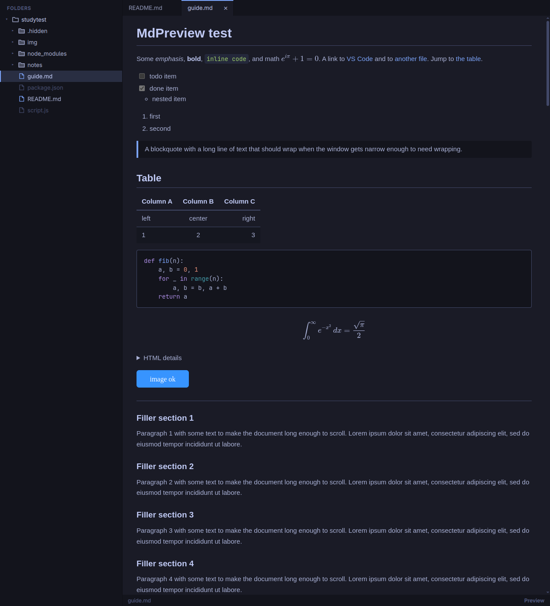
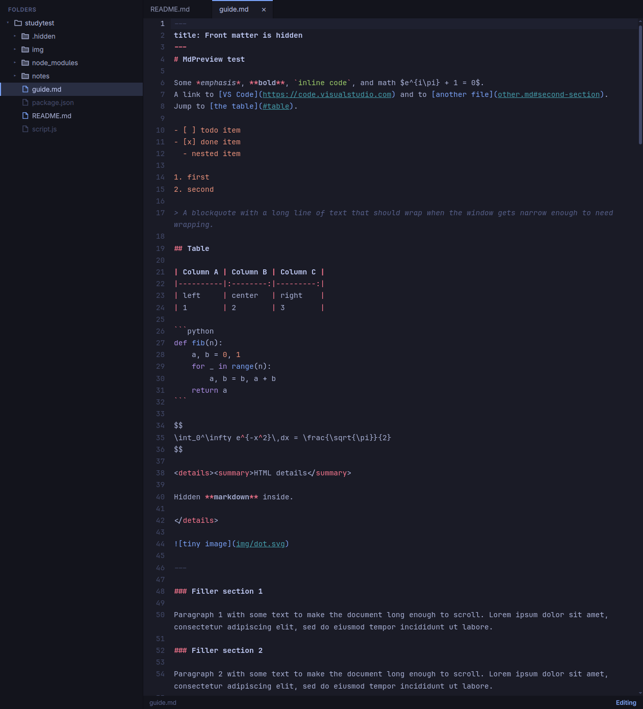

# Study



Study is a reader for folders of Markdown. Open a folder and every file and folder appears in a tree on the left, much as it does in Sublime Text. Click a Markdown file and it opens rendered in a tab, the way VS Code's preview shows it: tables, task lists, highlighted code, math and images. Rendering is the default. When you want to change something, Ctrl+Shift+V turns the tab into an editor for its source, and pressing it again goes back.

It is built the way Omarchy's own apps are: C++ and Qt Quick, one binary, keyboard first, following the Omarchy theme and language, and installed as an Arch package so it shows up in the app launcher. It is also the default app for `.md` files, so double-clicking one opens it in Study.

## Contents

- [Features](#features)
- [Install](#install)
- [Using Study](#using-study)
- [Shortcuts](#shortcuts)
- [What it renders](#what-it-renders)
- [Following the theme and language](#following-the-theme-and-language)
- [How it works](#how-it-works)
- [Files](#files)
- [Troubleshooting](#troubleshooting)
- [Development](#development)
- [Credits and license](#credits-and-license)

## Features

- **A folder tree** showing everything in the folder, dotfiles included, with version-control and build clutter (`.git`, `*.pyc`, `*.o` and so on) left out, as Sublime Text does. Markdown files open; everything else is shown dimmed.
- **Sublime Text style tabs.** A single click *peeks* at a file in a temporary tab (its name in italics), which the next peek replaces. A double click, or an edit, keeps the tab. Edited tabs show a dot. Tabs can be dragged into another order, closed with a middle click, and reopened with Ctrl+Shift+T.
- **Rendered by default** with [markdown-it](https://github.com/markdown-it/markdown-it), the parser VS Code uses, with the same GitHub-style heading anchors.
- **Edit the source** with Ctrl+Shift+V, in a [CodeMirror](https://codemirror.net) editor with Markdown highlighting (including the code inside fences), line numbers, undo, multiple cursors, and find and replace. Ctrl+S saves.
- **Double-click to edit:** double-clicking the rendered text opens the source with the cursor on that line. Switching back and forth keeps your place in the document.
- **Links work:** a link to another Markdown file opens it in a tab (and `file.md#heading` scrolls to the heading), `#heading` links scroll the page, and web links open in your browser.
- **Live reload:** a file changed by another program (Sublime Text, `git pull`, an AI agent) updates in its tab. A tab with unsaved edits is never overwritten; it asks whether to reload or keep your version.
- **Go to File** (Ctrl+P) with fuzzy search over every Markdown file in the folder.
- **Find in the page** (Ctrl+F), **zoom** (Ctrl+= / Ctrl+-), and a **hideable sidebar** (Ctrl+K Ctrl+B).
- **Picks up where you left off:** the folder, the tabs, each tab's mode and scroll position, and the window size come back the next time you start it.
- **One window:** opening another file while Study runs, from the file manager or the command line, adds a tab to the running window instead of starting a second one.
- **Safe with your files:** saves are atomic (written beside the file, then renamed over it), and quitting or closing a tab with unsaved edits asks first.
- **Fast:** rendering runs in a Web Worker and only the parts of the page that changed are updated, so typing in a long document or scrolling while a file reloads stays smooth.



## Install

Study is built for [Omarchy](https://omarchy.org) (Arch Linux with Hyprland), but runs anywhere Qt 6 with WebEngine does. Following the theme and the language needs Omarchy.

### 1. Dependencies

```sh
sudo pacman -S --needed qt6-base qt6-declarative qt6-wayland qt6-webengine qt6-webchannel qt6-svg xdg-desktop-portal
```

Building also needs `gcc`, `make` and [Node.js](https://nodejs.org) (with `npm`), which bundles the document page. If Node.js isn't installed, `mise use -g node` provides it.

### 2. Build and install

```sh
git clone https://github.com/orhunakkan/study.git
cd study
bin/install          # builds the package, installs it with makepkg -fsi, and makes Study the default for .md files
```

Study now appears in the app launcher (`Super + Space`), and `study` is on your `PATH`.

`bin/install` ends with:

```sh
xdg-mime default study.desktop text/markdown text/x-markdown
```

Run that yourself if you install the package another way, or skip it to keep your current Markdown app as the default.

### 3. Start it

```sh
study                       # the folder and tabs from last time
study ~/notes               # open a folder
study ~/notes/today.md      # open a file (and its folder, if none is open)
```

## Using Study

### Opening a folder

Press **Ctrl+O** (or the **Open Folder…** button on first start) and pick a folder in the desktop's folder chooser. Opening another folder replaces the one in the sidebar; tabs that are already open stay open until you close them.

### The sidebar

Click a folder to expand or collapse it. Click a Markdown file to peek at it; double-click to keep it open. Hovering over a dimmed file explains why it doesn't open: Study opens Markdown files only (`.md`, `.markdown`, `.mdown`, `.mkd`, `.mkdn`, `.mdwn`, `.mdtxt`, `.mdtext`). The file you're reading is highlighted in the tree.

### Tabs

| Action | How |
| --- | --- |
| Switch | Click the tab, Ctrl+Tab / Ctrl+Shift+Tab, Ctrl+PgDn / Ctrl+PgUp, or Alt+1 … Alt+9 (Alt+9 is the last tab) |
| Keep a peek tab | Double-click it, double-click the file in the sidebar, or start editing |
| Reorder | Drag the tab |
| Close | Ctrl+W, the × on the tab, or a middle click |
| Reopen | Ctrl+Shift+T reopens the most recently closed tab (it remembers the last 20) |

Two tabs with the same file name (two `README.md`s) show their folder too: `README.md — docs`.

### Preview and source

Every tab opens rendered. **Ctrl+Shift+V** switches it to the source and back; so does clicking **Preview** / **Editing** in the bottom-right corner, or **Edit Source** in the right-click menu. Each tab remembers its own mode.

Double-clicking anywhere in the rendered text switches to the source with the cursor on that line. Both views keep their scroll position in source lines, so switching modes, resizing the window, or zooming keeps the same part of the document in view.

### Editing and saving

The editor marks a tab as edited (a dot on the tab) as soon as its text differs from the file, and clears the mark if you undo back to the saved text. **Ctrl+S** saves the current tab. Closing an edited tab offers **Save**, **Don't Save** or **Cancel**; quitting with edits offers **Save All**, **Don't Save** or **Cancel**. The underlined letter on each button presses it.

In the editor, **Ctrl+F** opens CodeMirror's find and replace, and **Ctrl+Z** / **Ctrl+Shift+Z** undo and redo. Each tab keeps its own undo history while it's open.

### When files change on disk

Study watches every open file:

- **A tab without edits** reloads by itself, keeping its scroll position.
- **A tab with edits** shows a bar: **Reload** takes the version on disk and drops your edits; **Keep Mine** keeps your edits, and your next save overwrites the file.
- **A deleted or moved file** keeps its tab (its name struck through) with a note; saving writes it back.

### Go to File

**Ctrl+P** lists every Markdown file in the folder (skipping `.git`, `node_modules` and the other excluded folders). Type any part of the path, letters in order, and the best matches rise to the top: runs of letters, the starts of words and the file name count most. Use the arrows and Enter, or click.

## Shortcuts

| Keys | Action |
| --- | --- |
| Ctrl+O | Open a folder |
| Ctrl+P | Go to a Markdown file |
| Ctrl+Shift+V | Switch between preview and source |
| Double click | Edit the source at that spot |
| Ctrl+S | Save |
| Ctrl+F | Find (in the editor: find and replace) |
| Ctrl+W | Close the tab |
| Ctrl+Shift+T | Reopen the last closed tab |
| Ctrl+Tab, Ctrl+PgDn | Next tab |
| Ctrl+Shift+Tab, Ctrl+PgUp | Previous tab |
| Alt+1 … Alt+9 | Go to tab |
| Ctrl+K Ctrl+B | Show or hide the sidebar |
| Ctrl+= / Ctrl+- / Ctrl+0 | Zoom in, out, reset |
| Ctrl+Z / Ctrl+Shift+Z | Undo, redo (editing) |
| ? or F1 | Show every shortcut |
| Q (outside the editor), Ctrl+Q | Quit, asking first about unsaved edits |
| Escape | Close find, help or Go to File |

`?` and `Q` only work while you're reading, so typing them in the editor or a search field just types them.

## What it renders

- **CommonMark** and the GitHub additions VS Code's preview supports: tables (with column alignment), strikethrough, autolinked URLs, and raw HTML (`<details>`, `<kbd>`, `` with sizes and so on).
- **Task lists:** `- [ ]` and `- [x]` become checkboxes.
- **Code blocks** highlighted by [highlight.js](https://highlightjs.org) for every language it knows, named after the opening fence (` ```python `). Fences without a language stay plain, as in VS Code.
- **Math** with [KaTeX](https://katex.org): `$inline$`, `$$display$$`, ` ```math ` fences, and bare `\begin{equation}` blocks.
- **Front matter** (`---` YAML at the top) is hidden.
- **Images and video** from the web or next to the file. Relative paths resolve from the file's folder, and paths starting with `/` resolve from the opened folder, as in VS Code.
- **Heading anchors** match GitHub's, so `[link](#my-heading)` and `other.md#my-heading` work the same here as on GitHub. `#L42` scrolls to source line 42.

## Following the theme and language

Study reads the current Omarchy theme's `colors.toml` and watches it, so switching themes recolors the window, the rendered page, the code highlighting and the editor at once, light themes included. Window corners follow Hyprland's rounding.

Every label follows the language picked under Omarchy's Setup > Language, also live. Study ships English and Turkish; a missing translation falls back to English.

## How it works

The window is Qt Quick (`src/*.qml`), and everything that touches the disk is C++ (`src/backend.cpp`): the folder tree (a `QFileSystemModel` behind a filter), the tabs, reading and saving, watching files, and the session.

The document area is a single web page inside Qt WebEngine, the Chromium engine Qt ships, so it renders exactly as a browser would:

- `web/app.js` keeps one state per open tab and shows the active one. Markdown is rendered by markdown-it in a Web Worker (`web/worker.js`) with highlight.js and KaTeX, and the result is patched into the page by [morphdom](https://github.com/patrick-steele-idem/morphdom), so unchanged parts (and loaded images) stay put. Each tab's rendered HTML is cached, and so are highlighted code blocks and typeset formulas, so switching tabs is instant and re-rendering while you type only redoes what changed.
- Every rendered block carries the source lines it came from. Scroll positions are stored as source lines, and the mapping between lines and pixels is interpolated between blocks, which is what keeps your place across mode switches and window resizes.
- Editing uses one CodeMirror 6 view with a separate editor state (text, selection and undo history) per tab.
- The page and the C++ side talk over Qt WebChannel through a small `Bridge` object (`src/bridge.h`): the C++ side tells the page which documents are open and which is active, and the page reports edits and scroll positions and hands back text to save.
- The page loads from a private `study://app/` scheme compiled into the binary, and a document's local images come through `study://file/…`, so the page never gets general `file://` access.
- A second `study` process finds the first through a local socket (`study-<uid>`), hands over its paths, and exits.

## Files

| Path | What's there |
| --- | --- |
| `~/.config/study/session.ini` | The open folder, tabs (path, mode, scroll line), the current tab and recently closed tabs |
| `~/.config/study/study.conf` | Window size, zoom, sidebar width and visibility |
| `~/.local/state/omarchy/current/theme/colors.toml` | The theme Study follows (read only) |
| `~/.config/omarchy/language` | The language Study follows (read only) |

Delete `session.ini` to start with nothing open.

## Troubleshooting

**Double-clicking a `.md` file opens another app.** Make Study the default again:

```sh
xdg-mime default study.desktop text/markdown text/x-markdown
xdg-mime query default text/markdown     # should print study.desktop
```

**Ctrl+O does nothing, or says the folder chooser isn't available.** The folder chooser comes from `xdg-desktop-portal` and a backend for it (`xdg-desktop-portal-gtk` or `-hyprland` on Omarchy). Check that it's running: `systemctl --user status xdg-desktop-portal`. You can always open a folder from the command line: `study ~/notes`.

**The page is blank.** The document page is compiled into the binary from `src/web/dist`, which `web/build` generates. A build without Node.js leaves it empty: install Node.js and run `bin/build` again.

**A second window opened instead of a tab.** The first window may still be starting; try again once it's up. If a crashed instance left a stale socket, the next start removes it.

**Something went wrong in the page.** Run `study` from a terminal: warnings from the page are printed there with `page:` in front.

## Development

```sh
bin/build      # web/build when web/ changed, then qmake6 + make → build/study
bin/test       # builds and runs the Qt Test suite offscreen
bin/install    # makepkg -fsi, then the xdg-mime default
```

Run `build/study <folder or file>` to try a change without installing it.

The web dependencies are pinned in `web/package.json` and installed into `web/node_modules` on the first build. `web/build` bundles `web/app.js` and `web/worker.js` with esbuild into `src/web/dist` (not committed), copies the KaTeX styles and fonts, and writes the `web.qrc` that compiles them into the binary.

### Layout

```text
study.pro                 qmake project
bin/                      build, test, install
src/main.cpp              app setup, the study:// scheme, one-window handoff
src/backend.{h,cpp}       folder, tabs, files, saving, watching, session
src/bridge.{h,cpp}        what the document page can call and hear
src/filetree.{h,cpp}      the sidebar's filtered, sorted folder tree
src/tabs.{h,cpp}          the tab list model
src/schemehandler.*       serves study://app and study://file
src/singleinstance.*      the local socket for later launches
src/theme.*  translator.* Omarchy theme and language, followed live
src/portalfilepicker.*    the folder chooser through xdg-desktop-portal
src/*.qml                 the window: sidebar, tabs, overlays, dialogs
src/i18n/*.json           translations
web/app.js                the document page: preview, editor, scrolling
web/worker.js             markdown-it rendering off the main thread
web/style.css             the rendered page's look
tests/                    Qt Test suite
pkgbuild/                 PKGBUILD, .desktop entry, icon
```

## Credits and license

MIT; see [LICENSE](LICENSE).

- [markdown-it](https://github.com/markdown-it/markdown-it) (MIT) renders Markdown, with [markdown-it-front-matter](https://github.com/ParkSB/markdown-it-front-matter) (MIT) and [@vscode/markdown-it-katex](https://github.com/microsoft/vscode-markdown-it-katex) (MIT).
- [highlight.js](https://highlightjs.org) (BSD-3-Clause) highlights code, [KaTeX](https://katex.org) (MIT) typesets math, and [morphdom](https://github.com/patrick-steele-idem/morphdom) (MIT) patches the page.
- [CodeMirror 6](https://codemirror.net) (MIT) is the editor.
- The theme and language following, the portal folder chooser, the dialogs and the project layout follow Omarchy's apps (Omacut, Monologue) by David Heinemeier Hansson, under the MIT license.
